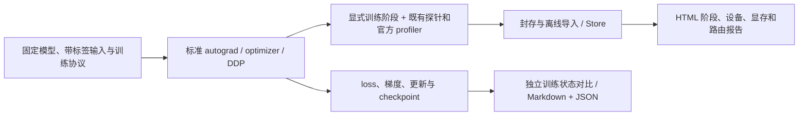

# Training v2：标准训练与观测

Training v2 在现有 `flagprof` 采集、厂商适配、Store 和离线报告上增加训练语义。它不复制 Inference v2 架构，也不替换已有 `training/run_benchmarks/run.py`。

当前提供标准 PyTorch 分类示例、本地 Hugging Face 因果语言模型训练、密封 CTR 语料上的模板架构训练、embedding/reranker 微调任务，以及给自有训练程序使用的阶段标记。小规模实测用于验证训练与观测闭环，不能当作模型收敛或独占性能认证。厂商和已知限制见[验证记录](v2-validation.md)。

## 运行流程



| 层次 | 实现与边界 |
|---|---|
| 执行 | `training/run.py` → `flagprof.training`；标准 autograd、SGD/AdamW、显式梯度累积、可选 AMP |
| 观察 | `phase()` / `step()` 复用用户 span 与 profiler 标记；不自动修改模型和数值策略 |
| 正确性证据 | 每步 loss、更新前梯度、更新后模型和优化器状态；accuracy 模式保存完整 CPU 快照 |
| 设备证据 | 复用官方采集器及其关联规则；没有明确关联的 kernel 不按时间邻近猜归属 |
| 分布式 | 标准 `torchrun` + DDP；每 rank 独立结果和 Store，不使用推理 TP2 的模型特定预期次数 |
| 恢复 | 在完整 optimizer step 后保存模型、优化器、显式 AMP scaler、Python/torch/当前设备 RNG 和下一步位置 |

## 环境

在仓库根目录运行。训练需要 PyTorch；`causal-lm` 另需支持模型的 Transformers、本地完整模型目录及预分词 JSONL。`training/run.py` 自动加入仓库的 `inference` 包路径；使用 `python -m flagprof…` 或 `torchrun -m` 前设置：

```bash
export PYTHONPATH="$PWD/inference${PYTHONPATH:+:$PYTHONPATH}"
```

P800 继续使用[原指南](../kunlunxin/inference-v2.md)锁定镜像、设备身份和 tracing 环境；PPU 使用[原指南](../thead/inference-v2.md)。镜像不由训练脚本自动拉取或替换。官方采集及 scratch 需要 ext4；先准备可写目录并设置 `FLAGPROF_SCRATCH`。

## 最小训练与采集

```bash
# 无采集基线；输出目录必须不存在
python3 -B training/run.py --device cuda:0 --outputs /data/train/base \
  --steps 3 --accumulation 2 --optimizer adamw

# 原协议不变，仅增加观察；thead 也可替换为已有 kunlunxin/nvidia 适配器
export FLAGPROF_SCRATCH=/data/train/scratch
python3 -B inference/run.py record --vendor thead --preset perf \
  --store /data/train/store --profile-memory --timeout 600 -- \
  python3 -B training/run.py --device cuda:0 --outputs /data/train/observed \
  --steps 3 --accumulation 2 --optimizer adamw

# 从 record 输出取得实际 Store 路径；不把 capture 目录当作 Store
python3 -B -S inference/run.py inspect /data/train/store/runs/RUN_ID --verify --json
python3 -B -S inference/run.py report /data/train/store/runs/RUN_ID \
  --out /data/train/report

# 默认零容差；相同精度也允许出现真实数值差异，不改策略追求一致
python3 -B -m flagprof.training.compare /data/train/base /data/train/observed \
  --out /data/train/comparison
```

`perf/modules` 使用完整官方会话，Store 通常在 `<store>/runs/`；`perf-lite/coverage/accuracy` 使用既有轻量接入，Store 在 `<store>/RUN_ID/`。以命令输出和 manifest 为准。

| 选项 | 含义 |
|---|---|
| `--mode accuracy`（默认） | 保存每步完整梯度、参数/缓冲区、优化器和 AMP scaler 状态；CPU 拷贝有开销，不能当作低扰动性能基线 |
| `--mode performance` | 不做每步完整快照；仍保存 loss、最终模型和实际协议，用于独立无采集计时 |
| `--amp off`（默认） | FP32 参数，保持框架默认数值开关；不修改 TF32、确定性、归约或算子实现 |
| `--amp bfloat16/float16` | 用户显式选择 autocast；FP16 使用标准 GradScaler；记录缩放因子与跳过更新；必须与对照使用相同协议 |
| `--batch-size` | 每 rank 的 microbatch 样本数；`global_samples = batch × accumulation × world_size` |
| `--accumulation` | 每个 microbatch 的标量 loss 除以累积次数再反向（等权 microbatch，变长 token 数不另做全局 token 加权）；DDP 非末次使用标准 `no_sync`，同时包住 forward/backward |
| `--steps` | 总 optimizer step 数；恢复时仍是原计划总步数 |

计时是同步整步墙钟，包含搬运、前向、反向、更新以及本模式的观察开销；不包含步后的快照、checkpoint 和结果写盘。首次编译/初始化保留在首次步骤中。正式性能实验须另行规定预热、重复和独占条件，不把这些功能结果称为合格性能。模型初始加载、哈希与最终保存也可能很慢。

## 本地因果语言模型

输入每行对应一个样本，`input_ids` 至少两个 token，可提供同长 `attention_mask`、`labels`。省略 labels 时使用 token IDs，mask=0 的位置设为 -100；预测目标按模型标准 next-token loss 处理。组内需显式等长 padding，不静默丢弃尾样本。

```json
{"input_ids":[1,42,17,2],"attention_mask":[1,1,1,1],"labels":[1,42,17,2]}
```

```bash
python3 -B training/run.py --task causal-lm --model /models/Qwen3-0.6B \
  --inputs /data/train/tokens.jsonl --device cuda:0 --batch-size 1 \
  --steps 3 --lr 0.0001 --optimizer adamw --outputs /data/train/qwen
```

本示例明确采用 FP32 参数和 eager attention，各平台同协议，不启用 `trust_remote_code` 或自动下载。原模型目录保持不变。不把 embedding/reranking 模型未经说明转成因果 LM；CTR 模板训练走下节的 `--task ctr`（派生标签 + 逐架构 loss），不把推理模板裸加 `.train()` 称为完整训练。

## CTR 训练（密封包语料）

`--task ctr` 在推理侧密封 `ctr-package-v1` 语料上训练 CTR 模板架构；包本身不改一字，加载时逐文件校验摘要。训练目标由 sample id 确定性派生（`sha256("ctr-train/click|cvr/<sample_id>")` 首字节 bit0），不经 RNG、不写入包；多任务架构同时使用 click/cvr 两路标签。各架构的 loss 消费推理前向的原样输出（sigmoid/余弦留在前向内，与推理 runner 一致）：

| 架构 | 前向输出 | 任务 loss |
|---|---|---|
| dlrm/din/widedeep/deepfm/dcn/sasrec/lightgcn | 原始 logit | BCEWithLogits(click) |
| bst/dien/dcnmix | 前向内 sigmoid | BCE(click) |
| esmm | [cvr, ctr, ctcvr] | BCE(cvr,cvr)+BCE(ctr,click)+BCE(ctcvr,click·cvr) |
| mmoe/ple | 两任务列 | BCE(任务0,click)+BCE(任务1,cvr) |
| dssm | 余弦 [-1,1] | MSE(余弦, 2·click−1) |

loss 区域固定 FP32（autocast 在任务 loss 内局部禁用）；协议逐字记录所用架构、loss 定义、标签规则和包/权重指纹。`ctr_weight_sha256` 使用与推理 runner 相同的种子和初始化，可与推理 `oracle_identity.weight_sha256` 直接对账。

```bash
# 语料与推理侧完全相同；batch-size 需 ≥2（BatchNorm1d 训练态），样本总数须是其整数倍
python3 -B training/run.py --task ctr --ctr-arch dlrm --package /data/ctr/ctr-seq \
  --device cuda:0 --steps 3 --accumulation 2 --outputs /data/train/ctr-dlrm

# 密封包由推理侧工具生成，训练不引入新语料格式
python3 -B inference/targets/make_ctr_package.py --samples 1024 --seed 531 --out /data/ctr/ctr-seq
```

DDP 按 rank 交错切分 microbatch 列表（每 rank 独立结果与 Store，同其他任务）。模型在 train 模式执行（BatchNorm 使用 batch 统计），这是训练协议与推理 runner 的既定差异，由协议与快照如实记录。

## Embedding 微调（三元组组语料）

`--task embedding` 在预分词三元组组语料上微调本地 embedding 模型：每行一组 `{"anchor":[ids],"pos":[ids],"negs":[[ids]×K]}`，K 全表一致；组数必须是 `--batch-size` 的整数倍，微批内按最大长度补零（attention_mask 记账）。模型用 `AutoModel` 加载（失败则回退 `AutoModelForCausalLM` 的主干），FP32 参数、eager attention、无网络下载；`--pooling last|cls|mean` 显式指定并记入协议。任务 loss 为批内负例 + 硬负例的 InfoNCE：L2 归一化池化向量，列按"各组正例、随后各自负例"排布，target 指向自身正例；loss 区域固定 FP32（autocast 局部禁用），温度 `--temperature` 进协议。

```bash
# 确定性预分词语料生成器（无 tokenizer、无文本、无网络；引擎输入摘要封存）
python3 -B inference/targets/make_embedding_corpus.py --groups 32 --negs 3 \
  --seed 531 --out /data/train/emb-groups.jsonl

python3 -B training/run.py --task embedding --model /models/bge-m3 \
  --inputs /data/train/emb-groups.jsonl --pooling cls --device cuda:0 \
  --steps 3 --accumulation 2 --outputs /data/train/emb
```

语料是确定性合成的 token 序列（不是真实检索数据），权重是真实本地模型；这验证的是微调通路与观测闭环，不声明检索精度。

## Reranker 微调（密封 rerank 包 + 派生相关性标签）

`--task rerank` 复用推理侧密封 `rerank-package-v1`（共享 loader 逐文件校验摘要，包不改一字）；相关性目标由 sample id 确定性派生（`sha256("rerank-train/<sample_id>")` 首字节 bit0），不写入包。打分语义必须与包 manifest 一致：

| `--rerank-score` | 模型类 | 任务 loss |
|---|---|---|
| `causal_yesno` | `AutoModelForCausalLM` | 末个有效位置 `[no,yes]` 两列的交叉熵（与推理打分同一 softmax） |
| `sequence_logit` | `AutoModelForSequenceClassification` | BCEWithLogits(头输出, 相关性 bit) |

```bash
python3 -B training/run.py --task rerank --model /models/Qwen3-Reranker-0.6B \
  --package /data/rerank/pkg --rerank-score causal_yesno --device cuda:0 \
  --steps 2 --outputs /data/train/rerank
```

协议记录包 oracle_id/inputs/contract/template 指纹与 `rerank_weight_sha256`（同种子可跨 run 对账）。大参数 reranker 受单卡显存约束：8B 模型 FP32 参数+AdamW+梯度约 128 GB，超出 96 GB 卡；FSDP/ZeRO 与 bf16 参数协议不在当前范围（见[验证记录](v2-validation.md)）。

## 已适配模型注册表与缺省输入

`inference/targets/model_registry.json` 记录已适配模型的任务默认值。`--task embedding` 命名注册表中的模型时可省略 `--pooling`（如 bge-m3→cls、Qwen3-Embedding→last），`--task rerank` 可省略 `--rerank-score`（Qwen3-Reranker→causal_yesno 生成式、bge/jina/ms-marco reranker→sequence_logit 判别式）；未适配模型仍要求显式传参并给出可选值。解析顺序是**显式旗标 > 注册表默认 > 报错**，所选来源以 `pooling_source`/`rerank_score_source` 记入协议；注册表条目带 `provenance`（`trained-verified` 表示该组合已在 PPU 上完成训练实测，`official-default` 表示采用厂商文档默认、未单独训练验证）。条目按模型目录名精确匹配，再按最长前缀规则兜底新变体。

CTR 任务必须显式选 `--ctr-arch`（14 架构之一，缺省报错会列出全部）；密封包可省略，缺省时在 `--outputs` 旁生成确定性默认语料（`*-default-corpus`/`*-default-package`，已存在则原样复用）。embedding 的 `--inputs` 同样可省略自动生成。确定性合成输入只验证通路与观测闭环，不替代真实数据；DDP 全部 rank 必须显式共享 `--inputs`/`--package`，缺省生成仅限单进程。

## 逐算子微基准（诊断，独立于采集）

`inference/tools/op_micro.py`（改编自 FlagScale Apache-2.0 的同名工具）在单一形状（B8 S512 H1024 FFN4096 vocab151669，bf16）下逐算子计时取中位数，用于跨芯片算子级差距定位。它是单卡诊断脚本：不进入 record 采集、不并入生产协议；与官方采集器的 kernel 归因互补，与训练结果的口径互不替代。

```bash
python3 -B inference/tools/op_micro.py --out /data/diag/op-micro-ppu.json --label thead-ppu --device cuda
```

## 检查点与恢复

```bash
python3 -B training/run.py --outputs /data/train/part --steps 5 --stop-after 2 \
  --optimizer adamw --checkpoint /data/train/checkpoint.pt
python3 -B training/run.py --outputs /data/train/resumed --steps 5 \
  --optimizer adamw --resume /data/train/checkpoint.pt
```

恢复需要相同模型初始化、输入、优化器及完整训练协议；脚本拒绝协议不匹配，不覆盖原结果。保存和恢复采用标准 optimizer state 与 RNG；不承诺不同硬件或非确定性 kernel 上逐位复现。只加载可信本地 checkpoint（包含 Python pickle）。内置循环仅支持固定 CPU batch 列表，绝不宣称能恢复任意 DataLoader worker、调度器或外部应用状态；自有程序需自行保存这些状态。

## 标准 DDP

```bash
torchrun --standalone --nproc-per-node=2 -m flagprof.training.distributed \
  --vendor thead --preset perf --store /data/train/ddp-store --timeout 600 -- \
  --ddp --backend nccl --device cuda --outputs /data/train/ddp-result \
  --steps 3 --accumulation 2
```

先按厂商指南限制可见设备并记录**两张卡的有序物理身份**；`LOCAL_RANK` 对应容器逻辑设备。`preset none` 可作为同入口无采集基线。DDP 每 rank 使用独立输入分片，checkpoint 路径自动加 `.rank-N`；`torchrun` 负责进程组生命周期和失败传播。请为整个任务设置外层 watchdog，`--timeout` 仅约束官方单 rank capture；轻量/DDP backend 也有自身超时，不能替代整任务回收。

可在不安装 torch/SDK 的环境生成可读的单卡或多 rank 摘要：

```bash
python3 -B -S -m flagprof.training.summary /data/train/ddp-result --out /data/train/ddp-summary
```

它检查 rank 覆盖、公共协议、最终参数与执行状态；本地吞吐不相加为全局吞吐。逐 rank 使用 `inspect/report` 与训练状态比较；不要调用推理 `report group.json` 推导 DDP 精度或吞吐。官方 trace 可保留 C++ collective，Python collective 探针不能证明捕获了所有 DDP reducer 通信。当前不提供跨主机训练部署、ZeRO/FSDP、TP/PP 或通用多 rank 性能归约。

## 自有训练程序

```python
from flagprof.training import phase, step, register_model
register_model(model)
for index, batch in enumerate(loader):
    with step(index, accumulation=1):
        with phase('zero_grad', step=index):
            optimizer.zero_grad(set_to_none=True)
        with phase('forward', step=index, microstep=0):
            loss = loss_fn(model(batch['x']), batch['y'])
        with phase('backward', step=index, microstep=0):
            loss.backward()
        with phase('optimizer', step=index):
            optimizer.step()
```

标记不插入同步、不更改原计算。未 attach 时不初始化采集器。完整阶段报告需 `step/zero_grad/forward/backward/optimizer`，并声明 accumulation 和各 microstep；缺失、重复或异常保留为 partial。跨线程上下文不自动传播。

`coverage` 的逐调用窗口对显式训练标记按 optimizer step 选择，覆盖拥有该上下文的 forward/backward/optimizer；未标记的推理仍按原 forward 规则。不能把主线程覆盖解释成所有 autograd 工作线程都已覆盖，也不能把前向 module 树直接解释为反向层归属。

## 结果与失败

| 文件 | 阅读方式 |
|---|---|
| `training-result.json` | 状态、完整协议、逐步 loss/吞吐、指纹；`complete` 仅表示已执行请求的步骤 |
| `step-N.pt` | accuracy 的更新前梯度、更新后模型与优化器；对比需要这些完整值 |
| `model-final.pt` | 最终模型参数与 buffer；不是完整可恢复 checkpoint |
| `report/report.html` | 训练阶段主机区间及原设备/显存/路由面板，离线无 torch/SDK 生成 |
| `exports/training-steps.jsonl`、`training-phases.jsonl` | 所有已采集阶段及覆盖缺口 |
| `comparison.md/json` | loss、梯度、模型与优化器逐项对比，明确容差；不同返回码 1，协议错误拒绝比较 |

不删除失败或重新运行目录。保留 target/collector/importer 返回码，不能因报告成功而把训练失败改成通过。精度对比需要相同协议；`--declare` 只允许显式记录 backend/world_size/rank 变化，并不证明输入或全局训练语义等价。两次恢复片段的覆盖不同会被拒绝，需单独核对连续与恢复结果。
