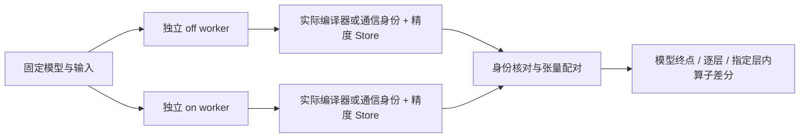

# FlagTree / FlagCX 精度对照

这两个开关改变被比较的实现；`--tensor-boundaries` 决定实际采集哪些张量。分别采集两侧后，用同一个 `report oracle` 入口比较。当前首批模型为 Qwen3-Embedding-0.6B，BF16、eager、固定参考输入；FlagCX 使用单机 TP2。



同一对照保持模型、输入、批划分、数值设置和采集边界相同，只允许声明的组件身份变化。TP2 两侧按相同 rank 配对，组报告将 12 个输入计为 12 个逻辑样本。

## FlagTree：选择实际编译器

FlagTree 在本批中编译 FlagGems 使用的 Triton 算子，模型执行模式保持 eager。

| 参数 | 行为 |
|---|---|
| 省略 `--flagtree` | 沿用当前环境，并记录实际导入的编译器 |
| `--flagtree off` | 使用封存的厂商 Triton-Ascend 包 |
| `--flagtree on` | 使用已安装的 FlagTree 分发包所提供的 Triton |

off 侧通过 `--vendor-compiler PATH` 指定带 `manifest.json` 的包，也可设置 `FLAGPROF_VENDOR_COMPILER`，命令行优先。厂商包由使用者准备：目录包含 `triton/` 与 `manifest.json`；manifest 的 `source_image` 记录来源镜像，`files` 将包内文件的相对路径映射到 SHA256（不含 manifest 和 `__pycache__`）。容器使用时只读挂载到所指定路径。on/off 在工作进程导入可选依赖前完成选择，不修改系统安装。

FlagTree 对照固定 `--flaggems on` 和同一 include，才能观察到真实 JIT 执行。编译器已安装或已导入，不等于模型执行了该编译器生成的算子；公共 `StoreView.probe_status()` 保留 `compiler_identity`、`compiler_execution`。JIT 计数表示 Python JIT 入口调用，不代表设备 kernel 覆盖率。缺少编译 listener 的厂商版本仍保留 JIT 观察，但不推断缓存命中或编译耗时。

下例在固定镜像内执行，模型、参考包、include、厂商编译器均为已准备的只读输入；`/evidence` 为本任务可写 ext4。

```bash
python -B -m flagprof record --vendor ascend --preset accuracy \
  --flagtree off --vendor-compiler /vendor-compiler \
  --flaggems on --flaggems-include /inputs/include.json \
  --tensor-boundaries layer --tensor-blob all --store /evidence/tree-off -- \
  python -B -m flagprof.runner hf:/models/qwen --inputs-from /oracle \
  --outputs /evidence/tree-off-outputs --device npu:0 --batch-size 1 --warmup 0 --forwards 1

python -B -m flagprof record --vendor ascend --preset accuracy \
  --flagtree on --flaggems on --flaggems-include /inputs/include.json \
  --tensor-boundaries layer --tensor-blob all --store /evidence/tree-on -- \
  python -B -m flagprof.runner hf:/models/qwen --inputs-from /oracle \
  --outputs /evidence/tree-on-outputs --device npu:0 --batch-size 1 --warmup 0 --forwards 1

python -B -S -m flagprof report oracle \
  --ref /evidence/tree-off/RUN_ID --cmp /evidence/tree-on/RUN_ID \
  --declare docs/examples/flagtree.json \
  --out /evidence/tree-report
```

缓存按编译器隔离。默认缓存位于任务 Store 旁；若多次运行需要复用，可设置 `FLAGPROF_COMPONENT_CACHE` 为本任务专属可写目录，实际编译器子目录仍独立。

## FlagCX：同规模 TP2 通信对照

`launch --flagcx off` 使用 HCCL，`--flagcx on` 使用 FlagCX。原有 `--comm-backend hccl|flagcx|nccl` 保留；同时指定时必须一致，两者均省略时使用 HCCL。P800、平头哥和 NVIDIA 继续显式指定 `--vendor` 与 `--comm-backend`。FlagCX on/off 是 Ascend TP2 选择，单卡没有该模型通信对照。

```bash
python -B -m flagprof launch --flagcx off --preset accuracy \
  --flagtree off --vendor-compiler /vendor-compiler --flaggems off \
  --tensor-boundaries layer --tensor-blob all --store /evidence/hccl -- \
  python -B -m flagprof.runner hf:/models/qwen --inputs-from /oracle \
  --outputs /evidence/hccl-outputs --batch-size 1 --warmup 0 --forwards 1

python -B -m flagprof launch --flagcx on --preset accuracy \
  --flagtree off --vendor-compiler /vendor-compiler --flaggems off \
  --tensor-boundaries layer --tensor-blob all --store /evidence/cx -- \
  python -B -m flagprof.runner hf:/models/qwen --inputs-from /oracle \
  --outputs /evidence/cx-outputs --batch-size 1 --warmup 0 --forwards 1

python -B -S -m flagprof report oracle \
  --ref /evidence/hccl/group.json --cmp /evidence/cx/group.json \
  --declare docs/examples/flagcx.json \
  --out /evidence/cx-report
```

launcher 为两 rank 分别选择设备与输出目录。每次执行使用独立 worker，Gloo 控制组与模型通信组分开编号；FlagCX native owner 保留到 worker 退出。任一 worker 失败时，launcher 停止并等待本次启动的其他 worker，保留各自日志和结果。

## 选择采集层级与读取结果

- 仅模型终点：将两侧都设为 `--tensor-boundaries model`。
- 逐层：使用 `layer`，也可省略该参数。
- 逐层并深入第 0 层：两侧增加 `--tensor-ops-in '<root>.layers.0'`，runner 使用 batch 1；可再用 `--samples truncate` 固定样本。
- 自定义边界：继续使用 JSON 模块路径列表。完整值由独立的 `--tensor-blob` 与预算控制。

组报告核对复制的模型／block 边界是否跨 rank 一致，再分别比较 rank 0 与 rank 0、rank 1 与 rank 1 的局部算子。不同 rank 的参数分片不要求相等；采集不额外 all-gather 张量。

集合通信的 dispatcher 返回不等于通信完成，因此 tensor 探针跳过 `c10d` 张量快照，并使跨越该边界的输入来源失效；后续本地算子仍保存输出，来源不完整的调用保留 `source_unknown`，不判 introduced。通信证据由独立 comm 事件及两个 rank 的模型／block 结果提供。这项边界与完整 blob 的数值配对分开解释。

精度报告先显示实际身份，再显示逐层、首差异及算子面板。声明中的 `software.triton` 仅允许 Triton 软件项变化，其他软件仍检查。`compiler` 包括实际来源摘要；`communication` 包括实际后端与可用的 FlagCX 源码摘要。旧 Store 没有这些字段时显示 `not_recorded`，不会补成 off。

纯算子 replay 在执行前恢复并核对编译器身份；厂商包搬迁后可用 `FLAGPROF_VENDOR_COMPILER` 指向同内容的包。集合通信不属于本批 replay 白名单。组件差分仍是描述性数值结果；性能用独立采集测量。

登记范围为 Qwen3-Embedding-0.6B × 910C 的单卡 FlagTree 和 TP2 HCCL / FlagCX，另有 OneRec 两后端 32-token 回归。历史真机验收覆盖数值差分、输出一致性与采集报告链路；未设置业务精度门限，也未形成稳态加速比结论。公共迁移的验证见 [迁移记录](migration.md#2026-11-10-成熟功能增量)。

## 性能与路由覆盖入口

相同组件参数可用于 `perf`、`modules`、`perf-lite`、`coverage`。下面的性能命令在相同输入和组件条件下分别执行两侧，使用不同输出目录：

```bash
python -B -m flagprof record --vendor ascend --preset perf \
  --flagtree on --flaggems on --flaggems-include /inputs/include.json \
  --store /evidence/tree-perf -- \
  python -B -m flagprof.runner hf:/models/qwen --inputs-from /oracle \
  --samples en-short --outputs /evidence/tree-perf-outputs --device npu:0 \
  --batch-size 1 --warmup 1 --forwards 2

python -B -m flagprof launch --vendor ascend --flagcx on --preset perf \
  --flaggems off --store /evidence/cx-perf -- \
  python -B -m flagprof.runner hf:/models/qwen --inputs-from /oracle \
  --samples en-short --outputs /evidence/cx-perf-outputs \
  --batch-size 1 --warmup 1 --forwards 2

python -B -S -m flagprof report /evidence/tree-perf/runs/RUN_ID --out /evidence/tree-perf-report
python -B -S -m flagprof report /evidence/cx-perf/group.json --out /evidence/cx-perf-report
```

对照侧分别改为 `--flagtree off --vendor-compiler /vendor-compiler` 或 `--flagcx off`，其余输入、组件、采集配置一致。`perf` 不启用精度张量探针；Qwen TP2 组报告从根模块 span 统计前向（含预热），登记模型每 rank 每次前向 56 次 AllReduce。OneRec 按生成步统计。缺少前向证据时计数判断为未知。同组设备占用比较允许 rank/device 编号不同，其他工作负载和窗口身份仍参与比较。

路由覆盖可将上述 `--preset perf` 改为 `--preset coverage`。launch 现可传入 `--flaggems` 和 include 列表；TP2 的组件实际支持范围以当前运行环境和登记验证为准。缺少 listener、设备关联、格式证明或输入来源时，报告继续保留 unavailable/partial 及具体原因。

## 公共配置与兼容

Python `attach(..., config={...})` 与 CLI 使用相同配置：`flagtree`、`vendor_compiler`、`tensor_boundaries`、`tensor_ops_in`。重复传递有效配置时会重新计算 include 摘要。显式组件选择或注册失败时，record、final capture 和 `with attach(...)` 均停止目标执行。

`StoreView.probe_status()` 返回 `compiler_identity`、`compiler_execution`；`report oracle` 支持 Store 对 Store 或 group 对 group。组报告的数值结果按相同 rank 展示，逐 rank 性能关联及 replay 参数仍传给单个 Store 入口。Store schema 继续为 1.2。
