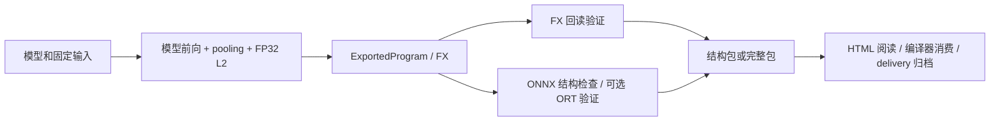

# 独立模型计算图导出

图导出读取模型与一个固定输入 batch，捕获 CPU 原生计算，再生成用于阅读的结构包或用于执行/编译器导入的完整包。当前内置入口为 Qwen3-Embedding；通用 Python API 接受显式 CPU 模型。图导出在独立 CPU 进程中执行。



沿这条链观察，导出包装器决定输出语义，FX 捕获决定输入约束，ONNX 转换决定交换格式。Store 保存实际运行事件；本功能独立生成计算结构，后续 profiling 关联可以使用模型、输入、模块来源和图内节点信息。

## 使用入口

在包含 PyTorch、Transformers、ONNX、ONNX Script 的已验证环境中，从 `inference` 执行：

```bash
python -m flagprof export hf:/path/to/Qwen3-Embedding-0.6B \
  --inputs inputs.jsonl --batch-size 4 --max-length 256 \
  --dtype bfloat16 --pooling last --formats fx,onnx \
  --bundle structure --out /path/to/new-structure

python -m flagprof export hf:/path/to/Qwen3-Embedding-0.6B \
  --inputs inputs.jsonl --batch-size 4 --max-length 256 \
  --dtype float32 --verify-onnx --bundle full --out /path/to/new-full
```

第二条还需要 CPU ONNX Runtime；它加载 FP32 模型重新导出，产生单独身份。它的数值通过结果仅适用于该 FP32 图。

文本输入复用 runner 的 JSONL 格式。也可用 `--inputs-from <固定输入参考包> --batch-index 0`，复用其中已封存的 tokens/mask。每次选择一个 batch；固定包的默认 batch-size 沿用来源，显式给出时按既有读取器重组。`--max-length` 是文本分词的截断上限，实际导出形状由该 batch 的 tokens/mask 决定。

默认 BF16、last pooling、left padding、eager attention、`use_cache=False`；`--pooling mean` 和 `--padding-side right` 可显式选择。输入 shape 固定，同一形状下仍接受不同 token 与有效 mask；其他 shape 需要重新导出。

`--formats fx`、`--formats onnx` 或默认两者选择产物；`--verify-onnx` 要求 FP32 与 ONNX 格式。工作进程超时默认 1800 秒，可通过 `--timeout` 修改。输出目录必须为新目录。

## 计算语义与验证

Qwen 的两个命名输出是 `pooled` 和 `output`：前者来自最后有效 token 或 mean pooling，后者将 pooled 转为 FP32 后执行 L2 归一化。计算函数与正常 embedding runner 共用。

FX 使用 `torch.export` 捕获 ATen 级计算图，保存后重新加载，并比较输出树、数量、shape、dtype、有限性及逐值结果。ONNX 使用 dynamo 路径和 opset 18；结构检查验证图的一致性。可选 ORT 使用 CPUExecutionProvider，并记录实际版本。

FP32 ORT 工程一致性判据为 rtol=1e-4；pooled 的 atol=1e-4，output 的 atol=1e-5。manifest 同时记录逐样本最大绝对误差、相对 L2 与通过结果。零范数参考且存在非零差异时相对 L2 为 null，保留绝对误差。这里衡量导出一致性；模型业务评分另有任务定义。

每种格式独立记录结果。ONNX 失败时保留成功的 FX，任务返回非零并显示 partial；捕获失败记录错误与 traceback。未请求 ORT 时明确标记 `not_run`。`export.log` 是诊断日志；`manifest.json` 是结构化结果。

## 两类产物与阅读

| 产物 | structure | full |
|---|---|---|
| manifest、index.html、FX/ONNX 结构 JSON、FX 文本 | 有 | 有 |
| model.pt2、model.onnx、ONNX external data | 验证成功后不保留 | 按请求格式保留 |
| example.pt：样例 args/kwargs、期望输出 | 验证成功后不保留 | 有 |
| 参数数值 | 无 | 有 |

结构包仍完成实际导出与验证；轻量指最终保存和传递的体积。失败保留临时现场，因此失败目录可能包含参数文件。

打开 `index.html`，按“格式 → 模块 → 节点 → 输入/使用者”阅读。节点详情提供 shape/dtype、模块来源及原始元信息；ONNX 未提供模块来源时归入图级节点。参数只在结构数据中列名称、形状与类型。图内节点 ID 配合格式结果中的 graph_id 使用；不同导出版本间的节点名不构成运行事件关联。

以下读取和 HTML 重建不需要 PyTorch/ONNX：

```python
from flagprof.graph import verify_graph, render_graph
print(verify_graph('/path/to/bundle'))
render_graph('/path/to/bundle', '/path/to/reopened.html')
```

HTML 重建路径位于图包之外，保留原包哈希。查看器采用离线自包含数据，支持搜索及上下游跳转。

## 编译器消费和独立回读

完整 ONNX 包的入口是 `model.onnx`；其 external data 必须一起搬运。FX 原件是 `model.pt2`，用登记的 PyTorch 版本加载：

```python
from pathlib import Path
import torch
root = Path('/path/to/full')
example = torch.load(root/'example.pt', map_location='cpu', weights_only=True)
with torch.inference_mode():
    graph = torch.export.load(root/'model.pt2').module()
    result = graph(*example['args'], **example['kwargs'])
```

加载原件不需要原 Hugging Face 模型目录。源模型哈希、输入哈希、shape/dtype、软件版本和导出设置仍保存在 manifest 中。当前交付通用图和参数；具体编译器的算子、opset 与 dtype 支持由该编译器的接入验证确定。

复用公共归档入口：

```bash
python -m flagprof delivery publish /path/to/full --out /path/to/new-archive
python -m flagprof delivery verify /path/to/new-archive
python -m flagprof delivery restore /path/to/new-archive --out /path/to/new-ext4-restore
```

restore 输出原路径到恢复路径的映射；使用该映射找到图包，再运行 `verify_graph` 与回读。当前 delivery 的恢复目录要求 ext4；独立 export 的输出没有 Writer 的文件系统限制。

## 接入其他 CPU 模型

```python
from flagprof.graph import ExportSpec, export_graph
spec = ExportSpec(model.eval(), (sample_tensor,), ('input',), ('output',),
                  identity={'model': 'my-model', 'revision': 'fixed-revision'})
result = export_graph(spec, '/path/to/new-export', formats=('fx',), bundle='full')
```

模型、参数、buffer 与样例张量须在 CPU。输出支持 Tensor 或非空平坦 Tensor tuple/list；输入名称按 `(args, kwargs)` 的张量叶子顺序排列，其他参数作为常量固定。调用者显式提供可追溯的模型身份。API 在无活动 attachment 的离线任务中执行；CLI 会启动独立工作进程。

DeepFM/DLRM 接入时复用 ExportSpec，分别补齐真实输入语义与 FX 验收。动态维度、OneRec 生成、KV cache、TP 和图到 profiling 的映射继续独立推进。

## 开发验证

无可选依赖时，`python3 -B -S -m unittest tests.store.test_graph_bundle -v` 验证离线包读取、完整性和 CLI。
实际 FX/ONNX/ORT 回归使用 `python3 -B -m unittest tests.store.test_graph_bundle tests.probes.test_graph_export -v`；运行前确认 torch、onnx、onnxscript、onnxruntime 均可导入。
CPU 依赖版本见 `tests/requirements-graph.txt`。生产离线报告和图包读取仍只依赖标准库。
