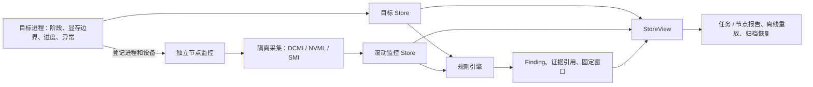

# 资源监控与在线诊断

资源监控把主机、设备和任务阶段放在同一条可核验的时间线上；在线诊断消费心跳、执行进度、异常和同步通信事件，输出带原始证据的 Finding。普通采集默认关闭两者。Ascend 和 NVIDIA 提供设备遥测，可通过 `flagprof watch start` 启动独立节点会话。平头哥 PPU 和昆仑芯 P800 在 `record --monitor on` 和训练观测中默认启动本地旁路进程，采集主机可用内存及目标进程 CPU/RSS。清单记录 `source=host-procfs` 和 `device_telemetry=unavailable`，这两个平台的本地拓扑不启用在线诊断。



目标进程负责记录事实，节点进程负责采样和判定。目标结束后，启动器补充实际退出回执；这样能区分目标异常与启动器超时、信号或同组其他进程失败。监控不可用时保留原因，目标继续执行。

## 从一个任务开始

安装后可从任意目录执行。以下示例在当前目录保存各类输出。独立监控可以由外部进程管理器托管，以下命令以前台方式运行：

```bash
# 在第一个终端保持节点监控运行
python3 -m flagprof watch start --root ./node --vendor ascend --devices all

# 在第二个终端进入同一工作目录，再查询和采集
python3 -m flagprof watch status --root ./node

python3 -m flagprof record --store ./tasks --vendor ascend --preset perf-lite \
  --monitor on --monitor-topology agent --monitor-root ./node --diagnose on \
  --target-device npu:0 \
  -- python3 target.py

python3 -m flagprof report ./node --last 1h --out ./node-report
python3 -m flagprof report ./tasks/RUN --out ./task-report
python3 -m flagprof watch replay ./node --out ./replay
```

自定义 Python 目标使用 `--target-device` 声明**脚本实际使用的进程内设备**。上例适用于在 `npu:0` 上推理的脚本，CUDA 示例为 `--target-device cuda:0`。请在脚本或运行环境中选卡。FlagProf 在目标进程中读取昇腾逻辑卡到物理芯片的映射或 NVIDIA GPU 的 UUID，再与节点设备清单匹配。使用 YAML 工作流时，为单卡 `target.type: command` 设置 `monitor.enabled: true` 和 `hardware.device: npu:0`。

脚本运行中才决定设备时，可在选卡后登记。内置 runner 与双卡 launch 已登记各自使用的设备。

```python
from flagprof import current_attachment

handle = current_attachment()
if handle is not None:
    handle.register_device(tensor.device)
```

任务报告里的逻辑设备和物理芯片可以与节点报告的设备清单核对。任务没有登记设备时，节点报告仍可查看整机曲线。声明与脚本登记指向不同芯片时，任务报告保存两侧映射并提示冲突，设备归属留空。板级功率覆盖整块板上的芯片。

NVIDIA 使用 `--vendor nvidia --devices all`。`launch` 支持同样的监控参数，单机 TP2 共用一个节点会话；组报告从 `group.json` 进入各 rank。跨容器任务使用同一宿主监控 agent，容器需挂载节点和目标目录的共同父目录，使引用路径保持可达。

`--diagnose on` 只用于 `perf-lite/perf/modules`，会选择 `monitor=on`、`topology=agent`，需要 `--monitor-root`。只看设备资源时省略 diagnose；`--preset monitor` 可采资源而不启用性能探针。快组默认 1000 ms，可通过 `--monitor-interval-ms 100..5000` 调整。独立 watch 的采样间隔与保留配置由启动时的 `--config` JSON 决定。

单次任务会探测本地采集能力。Ascend 在容器内优先使用可见的 `npu-smi`，宿主可使用 DCMI；NVIDIA 可使用 NVML 或 `nvidia-smi`。探测到相应接口时选择 `local`，缺少接口时选择 `host`，由宿主侧运行 `python3 -m flagprof.monitor --root ROOT --vendor ascend --devices all`。同一节点长期接多个任务时采用 `agent`，避免每个目标重复读取设备指标。

## 节点监控、YAML 采集与离线重放

节点可以连续监控多个任务。用 `watch start --config` 指定节点规则和采样周期，用各任务的 YAML 指定目标、采集预设和同一个监控目录。以下命令从同一工作目录运行。

1. 在监控终端执行 `flagprof watch start --root ./node --vendor ascend --devices 0 --config watch.json`。在任务终端用 `flagprof watch status --root ./node` 确认会话已运行。
2. 在任务 YAML 中设置 `monitor.enabled: true`、`monitor.topology: agent`、`monitor.root: ./node` 和 `monitor.diagnose: true`。先运行 `flagprof run task.yaml --check`，再运行 `flagprof run task.yaml --out job`。需要对照的任务使用同一个节点目录和新的任务输出目录。
3. 从每个任务的 `summary.json` 中读取 `type=store` 的产物路径。在节点收到各任务的退出回执后，结束自己启动的 watch。共享监控的生命周期由它的管理者负责。
4. 用 `flagprof report <任务 Store 路径> --out task-final` 和 `flagprof report ./node --out node-final` 查看同一会话的任务与节点报告。再运行 `flagprof watch replay ./node --out replay`，核对在线与离线诊断结果。

配套的可运行示例位于开发仓库 `runtime-team/dev/performance/docs/inference/runtime-diagnosis/`。该目录的 README、配置和启动脚本一起覆盖上述流程，包括等待退出回执、回收监控进程和核对重放结果。

## 指标如何解释

| 观测 | 计算和判读 |
|---|---|
| 设备、功率域、进程身份 | inventory 登记物理设备、功率域、驱动与启动身份；同一功率域只计一次 |
| CPU、RSS、设备利用率、功率、温度、频率、显存 | 通过隔离采样进程采集，API 超时或不支持保留缺失原因，成功读取的零仍为有效值 |
| load / warmup / measure / prefill / decode | runner 记录阶段边界；有共同主机时钟依据时与资源曲线对应 |
| allocated / reserved / device-used | 分别保留框架分配器、设备总量和来源；边界读取不调用 empty_cache 或强制设备同步 |
| 分配器外显存估算 | 需要同设备、有效空闲校准、相邻来源和独占证据；发现共享后停止目标独占估算 |
| 能耗与 J/token | NVIDIA 优先计数器差分，Ascend 使用功率积分；功率域归属及覆盖完整时才给出 token 归一值 |
| p95 与覆盖 | 使用来源有效时长和加权观测；不足分辨率、缺口和不够的有效点数单独保留 |

曲线缩减保留峰谷、端点和缺口，统计仍来自原始观测。缩短轮询间隔不会改变厂商指标本身的时间分辨率。采集和诊断的性能开销应在实际负载上单独比较。

## 在线规则与证据

节点基础规则覆盖采样缺口、采集调用超时、目标退出、设备错误和温度/功率限制。业务诊断增加以下规则：

| 规则 | 触发依据与结果 |
|---|---|
| OOM | 明确的 OOM 异常、分配消息和目标身份；保留发生位置与退出回执 |
| 心跳超时 | 来源身份、水位和心跳时限；断流或积压单独解释 |
| 执行停滞 | 有效执行进度未增长且超过阈值；未观测到进度时保留 unknown |
| 同步通信超时 | 同一通信域/序号、各 rank 的进入与返回证据；恢复时输出同 ID 的新修订 |

Finding 的发生起点、首次检出、后续修订和证据引用分别保存。`available` 表示能读取诊断数据，空 Finding 表示规则未报告异常；正常覆盖还需要有效执行观测。当前登记范围为短任务和单机 TP2 同步路径；短 measure 可能落在心跳间隔内，报告保留此覆盖缺口。任务重试、节点隔离、热加载、多节点通信、性能漂移和外部告警继续独立实现。

Python 入口为 `StoreView.monitor_status()`、`iter_monitor_events()`、`monitor_coverage()`、`iter_diagnostic_findings()`、`iter_diagnostic_evidence(ids)` 和 `iter_diagnostic_coverage()`。规则配置及版本跟随会话保存，重放核对完整 `(id, revision)` 和证据对象。

## 数据保留、归档和恢复

默认每 5 分钟或 32 MiB 轮转；节点预算 8 GiB，其中 256 MiB 用于控制和收尾。未固定原始数据保留最多 24 小时 / 3 GiB，分钟趋势最多 30 天 / 1 GiB。登记目标相关段与异常前 60 秒、后 30 秒窗口固定，窗口不完整时记录缺口。分钟趋势不能替代规则的原始证据。

```bash
python3 -m flagprof delivery publish ./tasks/RUN --out ./archives/run-delivery
python3 -m flagprof delivery verify ./archives/run-delivery
python3 -m flagprof watch release --root ./node \
  --reference ./tasks/RUN/monitor-ref.json --delivery ./archives/run-delivery
```

DCMI 采集在持有设备租约后测量本机的快速采样轮次，将采样下限写入监控目录的 `telemetry-sampling.json`。相同设备、驱动、SDK、启动实例、采集方式和指标描述可复用这一结果。

`release` 核对归档，在新目录恢复，比对公共事件身份与内容并重开报告，通过后解除该引用的固定。仍被其他任务引用的历史数据继续保留。归档目标由使用者选择。

继续修改时：采样与来源见 `telemetry/` 和 `vendors/*/telemetry*.py`；会话与保留见 `monitor/node.py`、`retention.py`；规则见 `monitor/rules.py`、`business.py`；读取和展示见 `store/view.py`、`analyzers/resource.py`、`monitor/diagnostic_report.py`。公共回归在 `tests/monitor/` 和 `tests/telemetry/`。
